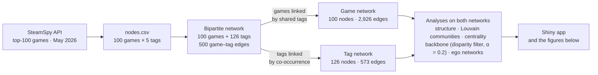
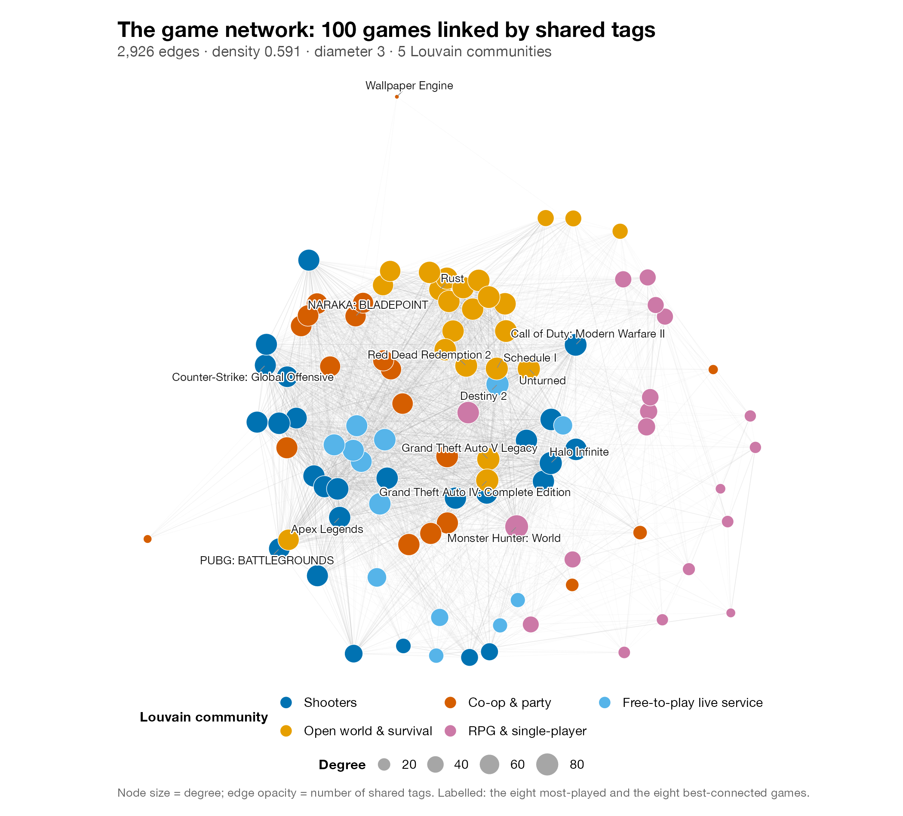
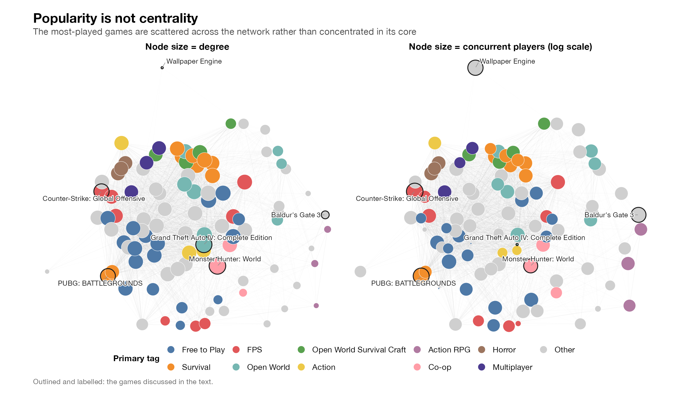
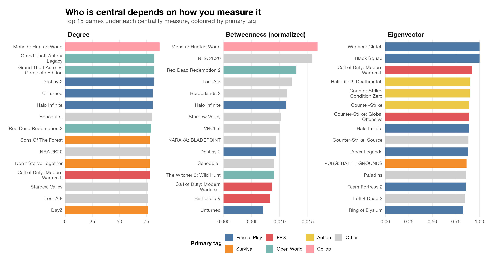
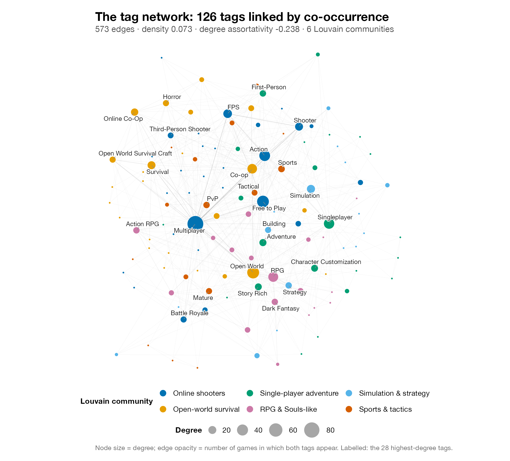
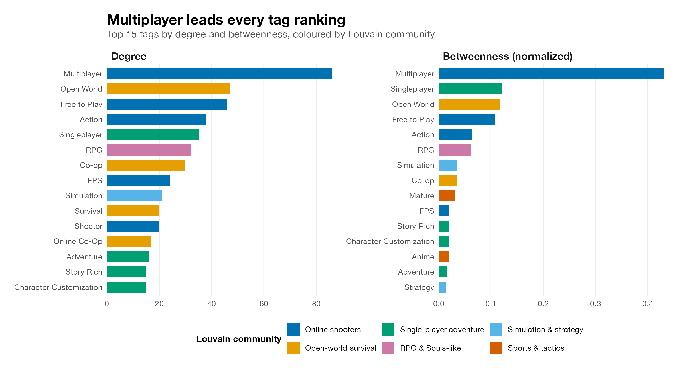
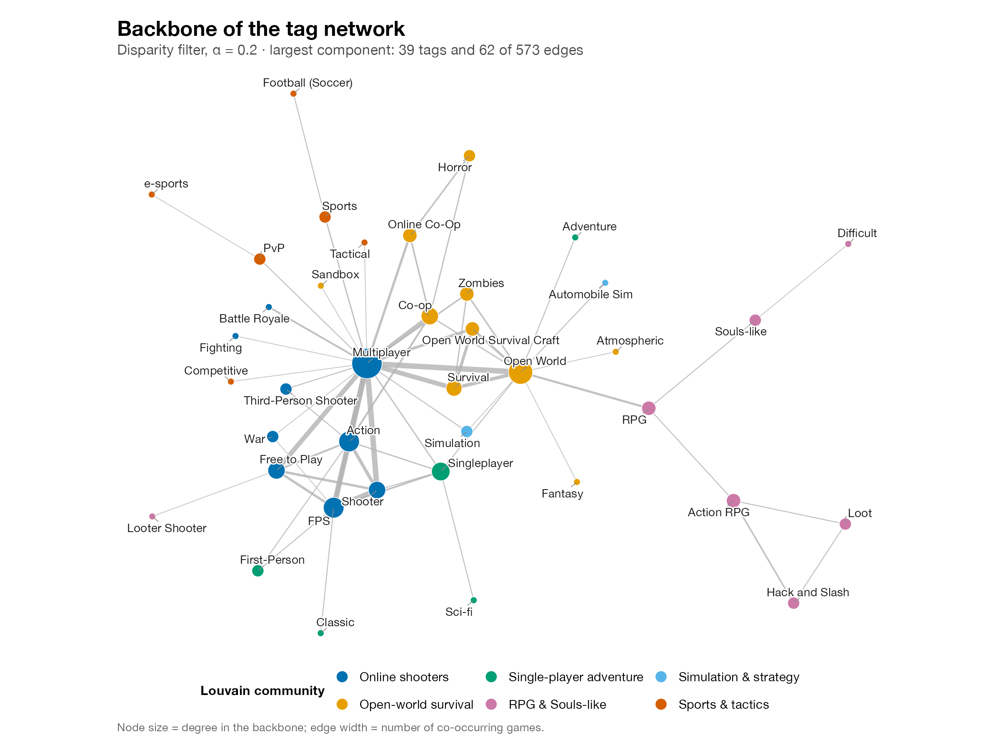
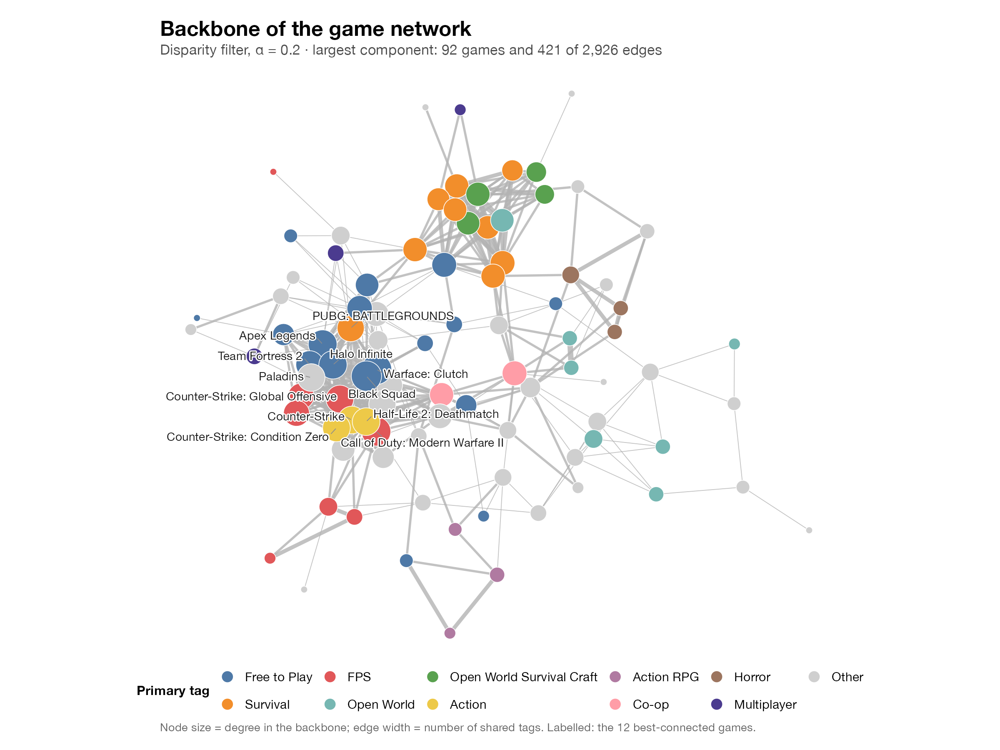
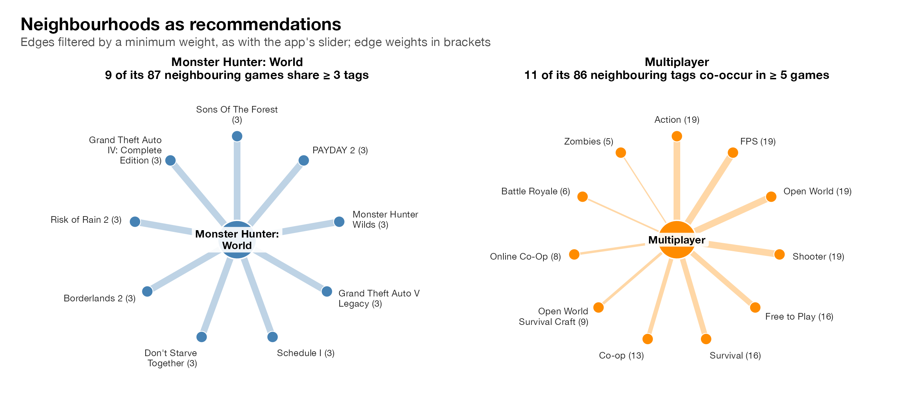

<p align="center">
  <picture>
    <source media="(prefers-color-scheme: dark)" srcset="figures/hero-tag-backbone-dark.svg">
    
  </picture>
</p>

<h1 align="center">Steam Video Game Network</h1>

<p align="center">
  How the 100 most-played games on Steam relate to one another through their gameplay tags:
  a bipartite game–tag network, projected two ways and explored in an interactive R Shiny app.
</p>

<p align="center">
  
  
  
  
</p>

---

Every game on Steam carries a handful of user-voted gameplay tags: *RPG*, *Multiplayer*, *Open World*, *Souls-like*. This project treats the 100 most-played games and their 126 distinct tags as a **bipartite network** and projects it two ways: a **game network**, where two games are linked when they share tags, and a **tag network**, where two tags are linked when they appear on the same game. Comparing the two projections shows how the contemporary video-game landscape is organized: which games sit at its core, which tags hold it together, and which genre families emerge from the overlap.

## Key findings

1. **The game network is dense and compact, and one tag accounts for much of that density.** 59% of all possible game pairs share at least one tag, and no two games are more than three steps apart. *Multiplayer* alone appears on 65 of the 100 games, linking 2,080 pairs: 71% of all edges.
2. **Popularity is not centrality.** Counter-Strike: Global Offensive, with over a million concurrent players, ranks only 41st of 100 by degree; Baldur's Gate 3 ranks 93rd.
3. **Each centrality measure picks out a different kind of game.** Degree favours games built on widespread conventions such as open world and survival; betweenness favours hybrids that bridge clusters; eigenvector centrality concentrates in a tightly knit shooter core.
4. **Tags fall into six meta-genres.** In the app's seeded Louvain run, the tag network splits into online shooters, open-world survival, single-player adventure, RPG & Souls-like, simulation & strategy, and sports & tactics, and its backbone shows what each group stands for. *Multiplayer*, which co-occurs with 86 of the other 125 tags, is the hub that ties them together.

## How it works



Edge weights count shared tags (game network) or co-occurring games (tag network). All of the analysis lives in [`app.R`](app.R); the figures below are regenerated from the app's own objects by [`analysis/make_figures.R`](analysis/make_figures.R).

## Results

### 1. A dense, compact network



With 2,926 edges among 100 games, the game network has a density of **0.591**: roughly six in ten game pairs share at least one tag. Its diameter is 3 and its mean distance 1.414, so almost any two top-100 games are one or two hops apart. Much of this density comes from a single tag: the 65 games tagged *Multiplayer* form a clique of 2,080 pairs on their own. Degree assortativity is moderately positive (**0.227**), so well-connected games tend to link to other well-connected games and the densely connected core is somewhat insular. Even so, the app's seeded Louvain run finds five groups, labelled here by their most frequent tags (Louvain partitions vary from run to run; see Methods).

### 2. Popularity is not centrality



Sizing nodes by concurrent players (CCU) instead of degree shows that commercial popularity does not map onto structural position. Counter-Strike: Global Offensive (1.01M concurrent players) ranks 41st by degree, PUBG (315K) 52nd and Baldur's Gate 3 (55K) 93rd; Wallpaper Engine, the fifth most-played title and not a game at all, has the lowest degree of any node (3). Conversely, the best-connected game, Monster Hunter: World (degree 87), had 12K concurrent players, and Grand Theft Auto IV, tied for second at degree 82, had none at the time of collection. Being a hit on Steam does not require a central position in tag space.

### 3. Who is central depends on how you measure it



The three measures reward different things. **Degree** is led by games whose tags are common conventions shared across genres: Open World, Survival and Free to Play titles such as Grand Theft Auto V and Destiny 2, plus several "Other" games. **Betweenness** swells the "Other" category further (NBA 2K20, Lost Ark, Borderlands 2, VRChat): bridging positions go to games with unusual or hybrid tag combinations that link otherwise separate clusters. **Eigenvector** centrality is entirely shooters (Warface: Clutch, Black Squad, Call of Duty: Modern Warfare II and the Counter-Strike series): all 15 carry the FPS or Shooter tag, and they share 3.4 tags with one another on average (1.47 across the whole network), so their heavily weighted mutual ties lift their scores.

### 4. The tag network: hub and spoke



The tag network is far sparser: 573 edges among 126 tags give a density of **0.073**, about an eighth of the game network's, with diameter 4 and mean distance 2.223. Its degree assortativity is negative (**−0.238**), the opposite of the game network: a few hub tags connect to many niche tags that rarely co-occur with each other, and half of all tags (63 of 126) appear on only one game. *Multiplayer* is by far the largest hub (degree 86). That fits the network effects multiplayer games enjoy, although a sample of top games alone cannot show whether the tag drives success.

<details>
<summary><b>Tag centrality rankings</b></summary>
<br>


*Multiplayer* leads both rankings; its betweenness (0.43) is more than three times that of the runner-up, *Singleplayer* (0.12).
</details>

### 5. The backbone makes the communities readable



The disparity filter keeps only edges that carry a statistically significant share of a node's total weight, exposing the network's skeleton: the backbone's main component retains 39 tags and 62 of 573 edges. It makes the six communities of the app's seeded Louvain run readable as meta-genres:

| # | Meta-genre | Representative tags |
|:-:|---|---|
| 1 | **Online shooters**, the largest and most central | Multiplayer, FPS, Shooter, Action, Free to Play |
| 2 | **Open-world survival** | Open World, Survival, Co-op, Open World Survival Craft, Zombies, Horror |
| 3 | **Single-player adventure** | Singleplayer, Adventure, Classic, Sci-fi |
| 4 | **RPG & Souls-like** | RPG, Action RPG, Souls-like, Hack and Slash, Loot, Difficult |
| 5 | **Simulation & strategy** | Simulation, Automobile Sim |
| 6 | **Sports & tactics** | Sports, Football (Soccer), PvP, Tactical, Competitive, e-sports |

<details>
<summary><b>Backbone of the game network</b></summary>
<br>


The game backbone's main component keeps 92 games and 421 of 2,926 edges. Its best-connected members are free-to-play and competitive shooters (Warface: Clutch, Black Squad, Call of Duty: Modern Warfare II, Apex Legends), the same shooter core that eigenvector centrality singles out.
</details>

### 6. Neighbourhoods as recommendations



The app's last view shows the neighbourhood of any game or tag, filtered by a minimum edge weight. Monster Hunter: World is linked to 87 games, but only nine share three of its five tags, among them its sequel Monster Hunter Wilds and co-op titles such as Risk of Rain 2, Borderlands 2 and PAYDAY 2; none shares four. *Multiplayer* co-occurs most often with FPS, Shooter, Action and Open World (19 games each). Raising the threshold turns the view into a simple tag-based recommender.

## Network statistics

| | Game network | Tag network |
|---|---:|---:|
| Nodes | 100 | 126 |
| Edges | 2,926 | 573 |
| Density | 0.591 | 0.073 |
| Diameter | 3 | 4 |
| Mean distance | 1.414 | 2.223 |
| Degree assortativity | 0.227 | −0.238 |
| Assortativity by primary tag | 0.013 | n/a |
| Modularity by primary tag | 0.012 | n/a |
| Louvain modularity | 0.172 | 0.338 |
| Louvain communities | 5 | 6 |

Assortativity and modularity by primary tag are close to zero: in a network this dense, a game's neighbours span all primary tags roughly in proportion to how common they are, so primary tags alone do not partition the game space.

## Data

The data were collected in May 2026 with a Python script that queried the [SteamSpy API](https://steamspy.com/api.php) for its top-100 games and recorded, for each game, the fields below. Games are ranked by concurrent users at collection time.

<details>
<summary><b>Data dictionary (<code>nodes.csv</code>)</b></summary>

| Column | Description |
|---|---|
| `node_id` | Steam app ID |
| `rank` | Rank by concurrent users (1 = most played) |
| `name` | Game title |
| `ccu` | Peak concurrent users on the day before collection |
| `owners` | Estimated owners (SteamSpy range) |
| `positive_reviews`, `negative_reviews`, `total_reviews` | Steam user reviews |
| `review_score` | Share of positive reviews (%) |
| `average_playtime_minutes` | Average playtime since March 2009, in minutes |
| `price_cents` | Price in US cents (0 = free) |
| `tags` | The game's five most-voted tags, separated by `; ` |
| `num_tags` | Number of tags (always 5) |
| `primary_tag` | The first (most-voted) of the five tags |

</details>

**Caveats.** The data are a single snapshot, and each game contributes only its five most-voted tags. The list also includes a few legacy titles with almost no concurrent players at collection time (e.g. Ring of Elysium, Heroes & Generals), so "most-played" follows SteamSpy's long-run ranking rather than current activity.

## Methods

<details>
<summary><b>Network construction and measures</b></summary>

- **Bipartite network.** Games and tags are the two node sets; each game links to its five tags (100 × 5 = 500 edges). `igraph::bipartite_projection()` produces the two one-mode projections, with edge weights equal to the number of shared tags (game network) or co-occurring games (tag network).
- **Structure.** Density, diameter and mean distance on the unweighted projections; degree assortativity on both; nominal assortativity and modularity by primary tag on the game network.
- **Communities.** Weighted Louvain (Blondel et al., 2008) via `tidygraph::group_louvain()`, with communities numbered by size. Louvain is stochastic: across repeated runs the tag network splits into five to seven communities and the game network into three to five, and their membership shifts. `app.R` therefore fixes the random seed (`set.seed(780)`, with the package versions pinned in `manifest.json`) so that it reproduces the partition described in the app's Findings. That partition is one of several Louvain finds; how robust the communities are is left for future work.
- **Centrality.** Degree, normalized betweenness and, for games, weighted eigenvector centrality.
- **Backbone.** Disparity filter (Serrano, Boguñá & Vespignani, 2009) at α = 0.2 via `backbone::backbone_from_weighted()` (Neal, 2022); isolated nodes are dropped and the largest connected component is shown.
- **Ego networks.** The one-step neighbourhood of a focal game or tag, keeping only edges at or above a minimum weight.

**References**

- Blondel, V. D., Guillaume, J.-L., Lambiotte, R., & Lefebvre, E. (2008). Fast unfolding of communities in large networks. *Journal of Statistical Mechanics: Theory and Experiment*, P10008.
- Csárdi, G., & Nepusz, T. (2006). The igraph software package for complex network research. *InterJournal, Complex Systems*, 1695.
- Neal, Z. P. (2022). backbone: An R package to extract network backbones. *PLOS ONE*, 17(5), e0269137.
- Serrano, M. Á., Boguñá, M., & Vespignani, A. (2009). Extracting the multiscale backbone of complex weighted networks. *PNAS*, 106(16), 6483–6488.

</details>

## Run it yourself

The Shiny app has three tabs: **Introduction** (overview, how to use, findings), **Game Section** and **Tag Section**. Each section shows the full network, Louvain communities, centrality rankings, network statistics, the backbone, and a neighbourhood explorer with a weight slider.

```r
install.packages(c("shiny", "tidyverse", "igraph", "tidygraph", "ggraph", "backbone", "plotly"))
shiny::runGitHub("steam-video-game-network-analysis", "JamesGuo111")
```

To regenerate the figures in this README (also needs `ggrepel` and `ragg`), run from the repository root:

```bash
Rscript analysis/make_figures.R
```

## Repository structure

```
.
├── app.R                # Shiny app: builds both networks and serves every view
├── nodes.csv            # 100 games with metadata and five tags each (SteamSpy, May 2026)
├── manifest.json        # Posit Connect deployment manifest
├── analysis/
│   ├── make_figures.R   # regenerates all figures from app.R's objects
│   └── hero_svg.R       # writes the animated header image
├── figures/             # figures used in this README
└── CITATION.cff         # citation metadata
```

## Citation

If you use this project, please cite it with **Cite this repository** in the sidebar, generated from [`CITATION.cff`](CITATION.cff).

<p align="center"><sub>Zijing Guo · built with R, igraph, tidygraph, ggraph and Shiny · data from SteamSpy</sub></p>
